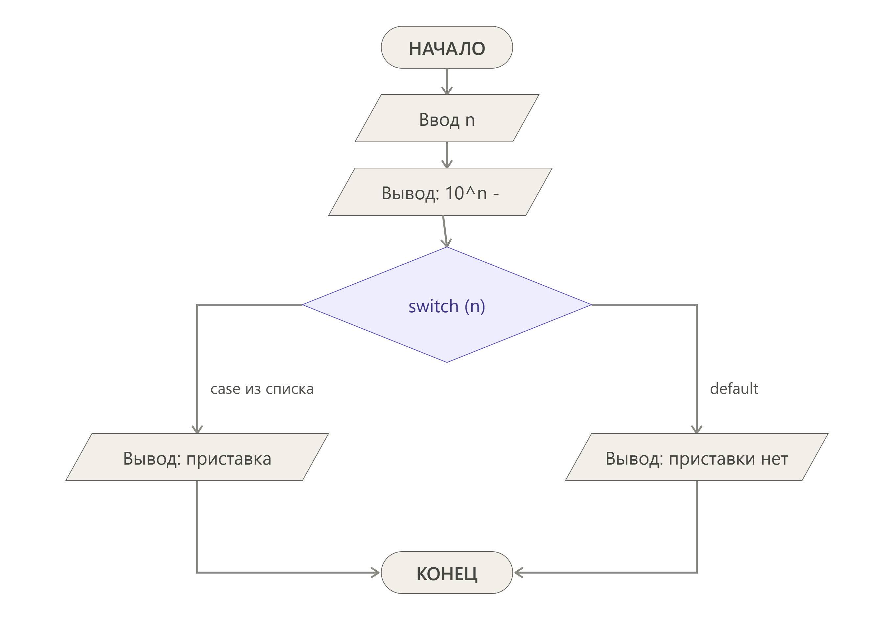

# Домашнее задание к работе 7

## Условие задачи
**Написать программу, которая интерпретирует степени 10 в соответствующие приставки вида «пико», «нано» ... «тера». Например: 10^-9 — нано, 10^3 — кило, 10^12 — тера. Использовать конструкцию if-else не рекомендуется — применять оператор switch.**

---

## 1. Алгоритм и блок-схема

### Алгоритм

1. **Начало**
2. **Ввод данных:**
   - Считать целое число n (показатель степени десяти)
3. **Вывод заголовка:**
   - Вывести "10^n - "
4. **Оператор switch (по n):**
   - n = -12 → вывести "пико"
   - n = -9 → вывести "нано"
   - n = -6 → вывести "микро"
   - n = -3 → вывести "милли"
   - n = -2 → вывести "санти"
   - n = -1 → вывести "деци"
   - n = 0 → вывести "без приставки"
   - n = 1 → вывести "дека"
   - n = 2 → вывести "гекто"
   - n = 3 → вывести "кило"
   - n = 6 → вывести "мега"
   - n = 9 → вывести "гига"
   - n = 12 → вывести "тера"
   - default (любое другое значение) → вывести "приставки для такой степени нет"
5. **Конец**

### Блок-схема


## 2. Реализация программы

```c
int TaskDZ() {
    int n;

    printf("Введите степень десяти (например, -9 или 6): ");
    scanf("%d", &n);

    printf("10^%d - ", n);
    switch (n) {
    case -12:
        printf("пико\n");
        break;
    case -9:
        printf("нано\n");
        break;
    case -6:
        printf("микро\n");
        break;
    case -3:
        printf("милли\n");
        break;
    case -2:
        printf("санти\n");
        break;
    case -1:
        printf("деци\n");
        break;
    case 0:
        printf("без приставки\n");
        break;
    case 1:
        printf("дека\n");
        break;
    case 2:
        printf("гекто\n");
        break;
    case 3:
        printf("кило\n");
        break;
    case 6:
        printf("мега\n");
        break;
    case 9:
        printf("гига\n");
        break;
    case 12:
        printf("тера\n");
        break;
    default:
        printf("приставки для такой степени нет\n");
        break;
    }

    return 0;
}
```

## 3. Результаты работы программы
Введите степень десяти (например, -9 или 6): -9
10^-9 - нано

## 4. Информация о разработчике
Сайкин Михаил Сергеевич, бТИИ-261
